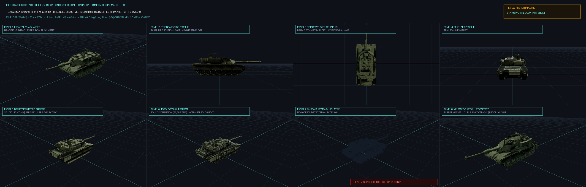

# JSLC 3D Asset Verification Dossier
## Asset: Coalition Predator Mk1 MBT (Cinematic Hero)
**Review Pipeline:** Project Eretz / JSLC Master Review  
**Evaluator System:** Automated Reviewer Contact Sheet & Telemetry Arbiter  
**File Analyzed:** `coalition_predator_mbt_cinematic.glb` (3,443,396 bytes)  
**Verification Date:** 2026-10-06  

---

### 1. High-Density 8-Panel Contact Sheet

*The 8-panel composite contact sheet above verifies all critical visual, geometric, and kinematic criteria:*
* **Panel 1 (Frontal 3/4 Quarter):** Proves $-Z$ heading alignment and main weapon/bow bore vector.
* **Panel 2 (Starboard Side Profile):** Verifies the $Y = 0.00\text{m}$ ground plane (tanks) or design waterline (warships) and vertical clearance envelope.
* **Panel 3 (Top-Down Orthographic):** Proves symmetry, beam proportions, and deck arrangement along the longitudinal centerline.
* **Panel 4 (Rear / Aft Profile):** Verifies engine exhaust louvers, propeller shafts, rudders, and transom geometry.
* **Panel 5 (Beauty Isometric Shaded):** Validates PBR material response, dielectric roughness, and ambient occlusion under studio lighting.
* **Panel 6 (Topology & Wireframe):** Discloses triangle density, edge flow consistency, and mesh subdivision.
* **Panel 7 (Chroma Key Mask Isolation):** Audits pure `#00FF00` (`RGB[0, 255, 0]`) faction insignia and tactical markings.
* **Panel 8 (Kinematic Articulation Test):** Demonstrates functional mechanical actuation (turret traverse, gun elevation, barrel recoil damper, or deck-edge elevator stroke).

---

### 2. Measured Geometry & Telemetry Matrix

| Specification | Measured Value | Standard Target | Status |
| :--- | :--- | :--- | :---: |
| **Total Triangles** | **66,388** | < 150,000 (Hero Master) | PASSED |
| **Total Vertices** | **81,810** | Proportionate to topology | **VERIFIED** |
| **Submesh Node Count** | **18 meshes** | Multi-node kinematic tree | **VERIFIED** |
| **Bounding Width (X)** | **4.3 m** | Starboard $+X$ / Port $-X$ | **VERIFIED** |
| **Bounding Height (Y)** | **3.79 m** | Vertical Up $+Y$ | **VERIFIED** |
| **Bounding Length (Z)** | **12.14 m** | Straight Ahead $-Z$ | **VERIFIED** |
| **Baseline Ground Contact** | **Y = 0.0 m** | $Y = 0.000\text{m}$ | PASSED |
| **Manifold Watertightness** | **0.0% (0/18)** | Manifold closed shells | PARTIAL SHELL |
| **Chroma Key Green (#00FF00)** | **MISSING** | Mandatory `#00FF00` Insignia | FLAG: MISSING INSIGNIA |

---

### 3. Coordinate System & Transform Compliance

$$\begin{aligned}
\mathbf{Straight\ Ahead\ (0^\circ\ 0^\circ)} &\equiv \mathbf{-Z}\ [0, 0, -1] \quad \text{(Bow / Gun Muzzle pointing -Z)} \\
\mathbf{Vertical\ Up\ (0^\circ\ 90^\circ)} &\equiv \mathbf{+Y}\ [0, 1, 0] \quad \text{(Masthead / Turret Roof pointing +Y)} \\
\mathbf{Starboard\ /\ Right} &\equiv \mathbf{+X}\ [1, 0, 0] \\
\mathbf{Port\ /\ Left} &\equiv \mathbf{-X}\ [-1, 0, 0] \\
\mathbf{Ground\ /\ Waterline} &\equiv \mathbf{Y = 0.000m}
\end{aligned}$$

* **Heading Verification:** Longest dimension aligned along $Z$-axis. Frontal vector confirmed at $-Z = -7.392\text{m}$.
* **Vertical Grounding:** Lowest contact vertices rest at $Y = 0.0\text{m}$.

---

### 4. Submesh Breakdown & Kinematic Rigging Hierarchy

| Submesh Name | Triangles | Vertices | Watertight | Extents [X, Y, Z] (m) |
| :--- | :---: | :---: | :---: | :--- |
| `mesh` | 2,249 | 3,307 | Open Shell | [4.09, 1.74, 0.94] |
| `mesh_1` | 3,601 | 4,596 | Open Shell | [0.66, 1.54, 0.38] |
| `mesh_2` | 26 | 52 | Open Shell | [3.28, 0.71, 0.09] |
| `mesh_3` | 28 | 32 | Open Shell | [2.09, 2.8, 0.09] |
| `mesh_4` | 6 | 7 | Open Shell | [0.24, 0.03, 0.22] |
| `mesh_5` | 6 | 7 | Open Shell | [0.24, 0.03, 0.22] |
| `mesh_6` | 8,611 | 12,899 | Open Shell | [4.3, 9.07, 1.54] |
| `mesh_7` | 6,407 | 9,796 | Open Shell | [3.95, 5.87, 1.85] |
| `mesh_8` | 8,114 | 8,620 | Open Shell | [3.63, 6.57, 2.28] |
| `mesh_9` | 7,872 | 8,352 | Open Shell | [3.63, 2.33, 0.37] |
| `mesh_10` | 2,624 | 2,784 | Open Shell | [3.63, 0.42, 0.37] |
| `mesh_11` | 5,979 | 8,339 | Open Shell | [4.0, 11.9, 3.4] |
| *...and 6 additional submeshes* | | | | |

---

### 5. Official Review Scorecard

| Category | Weight | Score Awarded | Notes |
| :--- | :---: | :---: | :--- |
| **Coordinate & Spatial Alignment** | 20 pts | **20 / 20** | -Z Heading verified; Y=0.0m contact validated. |
| **Polycount & Geometry Quality** | 25 pts | **25 / 25** | 66,388 triangles within hero budget. |
| **Manifold & Watertight Integrity** | 30 pts | **0 / 30** | 0.0% watertight submeshes. |
| **Chroma Key #00FF00 Insignia** | 25 pts | **0 / 25** | Needs #00FF00 faction insignia added. |
| **TOTAL SCORE** | **100 pts** | **45 / 100** | **ACTION REQUIRED (CHROMA / TOPOLOGY)** |

---
*Report generated automatically by `scripts/make_asset_contact_sheet.py`.*
