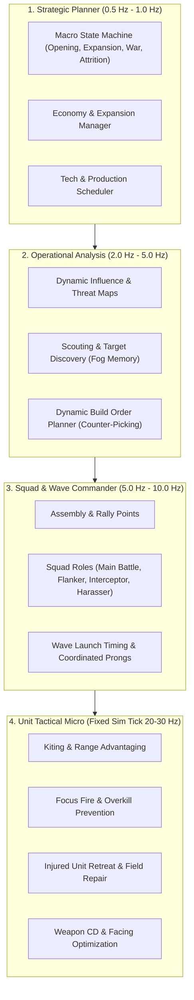

# RTS Game Design, Skirmish AI & Balance Standard

This standard establishes the normative engineering and game design rules for high-performance, deterministic RTS skirmish AI, balance modeling, and simulation architecture. It draws directly from the battle-tested paradigms of EA Los Angeles' SAGE engine (*Command & Conquer: Generals* and *Zero Hour*) while modernizing them with hierarchical agent design, influence maps, dynamic squad composition, and strict lockstep determinism.

---

## 1. Zero Hour Mechanical Reference & SAGE Architecture

### 1.1 Macro-Economy & Resource Dynamics
Zero Hour's economy is distinct in RTS history: high upfront capital, finite local supplies, rapid depletion, and long-tail secondary income.

* **Starting Capital:** Standard competitive skirmish starting purse is **$10,000** (tunable to $5,000, $20,000, $50,000). A $10,000 start finances: 1 Command Center (free/initial), 1 Power Plant ($800–$1,000), 1 Barracks ($500), 1 Supply Center/Depot ($2,000), 1 War Factory ($2,000), 1 extra Harvester/Chinook ($600–$1,200), leaving ~$3,000 for immediate defense/units.
* **Primary Resource Flow (Supplies):**
  * **Supply Docks:** Contain **$30,000** in supplies ($100 per physical box/crate).
  * **Supply Piles:** Contain **$15,000** in supplies ($100 per crate).
  * **USA Chinook:** $1,200 cost. Carries **4 boxes ($400)** per roundtrip. Flight speed allows rapid cycle (~12–15s on standard layout = ~$1,600–$2,000/min per Chinook).
  * **China Supply Truck:** $600 cost. Carries **2 boxes ($200)** per roundtrip. Ground pathing and turnaround latency (~18–24s = ~$500–$660/min per truck; optimal ratio: 2 trucks per depot).
  * **GLA Worker:** $200 cost. Carries **1 box ($75 or $100)** with slow pack/unpack animation (~15s = ~$300–$400/min per worker; optimal ratio: 5–6 workers per Supply Stash).
* **Secondary Economic Generators (Lategame Inflation Guard):**
  * **USA Drop Zone:** $2,500 cost, 4 power. Drops $1,500 crate every 2 minutes (~$750/min passive).
  * **China Hacker:** $625 cost, infantry. Internet Hack: Rank 1 ($5/2s = $150/min) up to Rank 3 ($10/2s = $300/min).
  * **GLA Black Market:** $2,500 cost, no power. Generates $20 every 2.5s (~$480/min passive) plus science unlock access.
  * **Neutral Oil Derricks:** $1,000 capture cash infusion + $200 every 12 seconds (~$1,000/min passive continuous).
* **Power Grid Calculus:**
  * Surplus: $100\%$ operational efficiency.
  * Brownout / Low Power: Build queues run at **$50\%$ speed (double build time)**. Radar / Mini-map shuts down. Powered base defenses (Patriot Battery, EMP Patriot, Laser Turret) become completely inert or fire at minimal rates. GLA operates without an electric grid (cost paid in vulnerability and structural durability).

### 1.2 Combat Armor & Damage Type Matrix
The SAGE engine utilizes an asymmetric damage-type vs. armor-type matrix rather than flat subtraction.

| Weapon Damage Type | Infantry / Soft | Light Armor / Technical | Main Battle Tank | Heavy / Super Heavy | Fortified Structure | Aircraft |
| :--- | :--- | :--- | :--- | :--- | :--- | :--- |
| **SMALL_ARMS** (Rifles, MGs) | **100%** | 50% | 15% | 10% | 10% | 20% |
| **SNIPER** (Pathfinder, Jarmen) | **200% (Instant OHK)**| 0% | 0% | 0% | 0% | 0% |
| **ARMOR_PIERCING** (Tank Cannons) | 25% | **100%** | **100%** | **100%** | 50% | 15% |
| **ROCKET / MISSILE** (RPG, Patriot) | 50% | **120%** | **100%** | 75% | **100%** | **150%** |
| **EXPLOSIVE / ARTILLERY** (Howitzer) | **150%** | **100%** | 75% | 50% | **150%** | 0% |
| **MICROWAVE / LASER / TOXIN** | **200%** | 75% | 50% | 35% | 50% (Clear Garrisons)| 50% |

### 1.3 General's Powers & Area Denial
* **Rank Progression:** Rank 1 (Command Level 1) -> Rank 3 -> Rank 5 (5-Star General).
* **Key Tactical Roles:**
  * **Recon:** Spy Satellite, Radar Van Scan, Vision Drops (duration: 15–30s).
  * **Precision Interdiction:** A-10 Warthog Strike, Spectre Gunship, Artillery Barrage.
  * **Strategic Denial:** Daisy Cutter, Carpet Bombing, Anthrax Bomb, EMP Strike.
  * **Economy / Sustain:** Emergency Repair, Cash Drop, Ambush (spawns 4–10 Rebels behind enemy lines).
* **Superweapons:** Particle Cannon, Nuclear Missile, SCUD Storm. Authoritative $6:00$ min timer. Target prioritization: Enemy Superweapon -> Command Center -> War Factory/Production -> Dense Unit Cluster.

### 1.4 How SAGE Handled Hard and Brutal AI
In retail *Generals Zero Hour*, the AI execution relied on `AIData.ini` and compiled script files (`SkirmishScripts.scb`):
1. **AttackPrioritySet:** Units and structures were weighted with numeric priorities (e.g., Harvesters = 100, Base Defenses = 80, Power = 70, Production = 60).
2. **TeamTemplates & Recruiters:** The AI maintained virtual "Teams" (e.g., `RushTeam`, `FlankTeam`, `HarasserTeam`). Factory queues did not build units blindly; a team requested specific unit archetypes, and as units rolled out of the War Factory, the recruiter assigned them to the staging area until the team was full.
3. **The Brutal AI "Cheats":**
   * *Economy multiplier:* Brutal AI in Zero Hour received **+100% income bonus** (each supply box fetched double credits) and a starting credit multiplier ($2\times$).
   * *Omniscient Map Vision:* SAGE Skirmish AI bypassed Fog of War for targeting, knowing exact player coordinates without scouting.
   * *Instant Reaction:* Near-infinite APM on target re-acquisition and ability triggers.

---

## 2. Modern RTS Skirmish AI Architecture Patterns

To create a **Hard AI** that feels brilliant, threatening, and human-like *without* artificial resource cheats, the architecture must operate in four coordinated tiers:



### 2.1 The Strategic Layer: Macro State Machine
* **States:**
  * `EXPANDING`: Under-saturated economy; prioritize Supply Depots, Harvesters, and Oil Derricks.
  * `TECHING`: Safe perimeter established; allocate $30–$40\%$ of income to tech structures and superweapons.
  * `PRESSURING`: Constant small-squad harassment to disrupt player expansion.
  * `DECISIVE_ENGAGEMENT`: Assembling critical mass ($> 65\%$ unit cap or maximum supply ceiling) for base-ending push.
  * `TURTLE_COUNTER`: If player is entrenched behind defensive walls/turrets, transition production to long-range artillery and air strikes.

### 2.2 Operational Layer: Influence Maps (IM)
An RTS AI without spatial reasoning is blind. The game field is divided into a coarse 2D cell grid ($4\times 4$ or $8\times 8$ meters per cell):
1. **Threat Field ($I_{\text{threat}}$):** Aggregated dps and weapon ranges of known enemy units, decaying with distance:
   $$I_{\text{threat}}(x, y) = \sum_{e \in \text{Enemies}} \frac{\text{DPS}_e}{1 + \alpha \cdot \text{dist}(e, (x, y))^2}$$
2. **Vulnerability Field ($I_{\text{vuln}}$):** High around undefended resource nodes, lone harvesters, unescorted artillery, and isolated power plants.
3. **Friendly Presence Field ($I_{\text{friendly}}$):** Aggregated health and firepower of allied combat units.
4. **Tension Field ($I_{\text{tension}} = I_{\text{threat}} \times I_{\text{friendly}}$):** Highlights active front lines.
5. **Path Safety Query:** Squad routes compute line integrals across $I_{\text{threat}}$ to avoid choke-point ambushes and static turret arcs.

### 2.3 Tactical Layer: Dynamic Squad Roles & Wave Timing
Never send units in an uncoordinated single-file conga line. The AI groups units into **Squads** with authored operational roles:
* **Role 1: Main Line (Anchor):** Heavy armor (Tanks) and anti-tank infantry. Absorbs fire, holds choke points, pushes main avenues.
* **Role 2: Fire Support:** Artillery (Tomahawks, Inferno Cannons). Kept strictly in the backline, bombarding stationary targets from beyond defensive range.
* **Role 3: Flank & Harass:** High-speed wheeled vehicles or light aircraft. Uses high-vulnerability routes identified by the influence map to flank around the front line and strike Harvesters or lone Power Plants.
* **Role 4: Air Defense & Escort:** Mobile AA attached to Main Line to prevent enemy aircraft strikes.
* **Staging & Assembly:**
  * When a wave is scheduled, units rally at an **Assembly Point** outside the friendly base.
  * The wave does NOT move into combat until the squad composition reaches its quota (e.g., 3 Tanks + 1 Artillery + 2 Infantry) OR a maximum staging timeout (e.g., 20 seconds) expires.
  * If a unit drops below $25\%$ HP during combat, it breaks formation, shifts to `retreat` back to the friendly repair facility/Command Center, and frees its slot for a reinforced unit.

---

## 3. Difficulty Scaling Without Cheating

> [!CAUTION]
> **The Anti-Cheating Mandate:**
> A truly great skirmish AI must defeat players through superior macro timing, counter-composition, spatial map control, and decisive flanking—**not** by granting itself free gold or psychic vision. Players immediately detect and resent cheating AI.

| Capability / Dimension | Easy AI | Medium AI | Hard AI | Brutal AI (No-Cheat Mastery) |
| :--- | :--- | :--- | :--- | :--- |
| **Command Interval (APM)** | 1.5s–2.0s (30–40 ticks) | 0.6s–1.0s (12–20 ticks) | 0.15s–0.25s (3–5 ticks) | 0.10s–0.15s (2–3 ticks) |
| **Fog of War Compliance** | Strict; scouts rarely | Strict; scouts main lanes | Strict; active scout cycling & memory map | Strict; predictive ISR & radar scan usage |
| **Counter-Picking** | Blind static build list | Reacts slowly (2+ min lag) | Dynamic counter weighting | Preemptive tech & hard counter pivots |
| **Wave Coordination** | Conga-line trickle | Single rally point; uniform attack | Multi-prong (Main pin + Flank harvesters) | Multi-prong + Artillery kiting + Decoy feints |
| **Focus Fire & Micro** | Random targets in range | Focuses lowest HP in range | Optimal threat targeting + overkill prevent | Focus fire + stutter-step + shield/hull cycling |
| **Injured Unit Behavior** | Fights to death | Hesitates | Retreats to repair at $25\%$ HP | Retreats & micro-kites while reload cycling |
| **Economic Expansion** | Single base only | Expands when dry | Secures secondary supply at 4:00 | Aggressive oil derrick grabs & double-expand |
| **Resource Handicap** | $0.7\times$ income | $1.0\times$ (standard) | $1.0\times$ (fair) | $1.0\times$ (fair, perfect efficiency) |

---

## 4. Determinism Rules for RTS Simulation AI

In a lockstep RTS engine (20 Hz or 30 Hz), the AI controller is **an intrinsic part of the deterministic state**. Any divergence between client executions desynchronizes the entire match.

1. **Rule 1: Zero Math.random() & Zero Wall-Clock Time:**
   * Never call `Math.random()`. All stochastic decisions (e.g., target jitter, randomized flank paths, scouting routes) MUST use `sim.rng()` (seeded xorshift128+ or splitmix32 PRNG).
   * Never query `Date.now()`, `performance.now()`, or `setTimeout`. The only clock is `sim.tick`.
2. **Rule 2: Stable, Deterministic Iteration Order:**
   * JavaScript `for...in` and raw `Object.keys()` on unordered dictionaries exhibit engine-dependent iteration orders.
   * All unit loops, candidate evaluations, and tie-breakers MUST have deterministic tie-breakers (e.g., `if (dist === bestDist) return candidate.id < best.id`).
   * Sets and Maps storing entity IDs must be iterated with sorted IDs when making state-altering decisions.
3. **Rule 3: Fog-of-War Memory Isolation:**
   * The AI player state MUST have an explicit `AiMemory` struct containing only units currently or previously seen in line-of-sight.
   * If an enemy unit enters the fog, its last known position and timestamp are stored. The AI must never read raw coordinates from `sim.units` of enemy players unless verified against friendly sensor envelopes.
4. **Rule 4: Order Pipeline Purity:**
   * The AI interacts with the simulation through the EXACT same order API as human players (`sim.issue(unit, order)`).
   * The AI never mutates `unit.x`, `unit.y`, `unit.hp`, or `sim.credits` directly. It queues actions into the tick order queue.

---

## 5. Faction-Agnostic & Data-Driven Design

Torch's canonical factions (**Coalition**, **Directorate**, **Network**) will replace test factions over time. The AI codebase must remain completely decoupled from specific unit names.

### 5.1 Authoritative Type Contracts

```typescript
export type CombatRole =
  | 'harvester'
  | 'infantry_line'
  | 'infantry_anti_tank'
  | 'main_battle_tank'
  | 'scout_light_armor'
  | 'artillery'
  | 'anti_air'
  | 'tactical_aircraft'
  | 'superweapon';

export type StructureRole =
  | 'commandCenter'
  | 'powerPlant'
  | 'barracks'
  | 'warFactory'
  | 'airfield'
  | 'defenceTurret'
  | 'resourceDepot'
  | 'techLab';

export interface FactionAIProfile {
  readonly factionId: string;
  readonly preferredOpening: readonly StructureRole[];
  readonly unitRoles: ReadonlyMap<string, CombatRole>;
  readonly counterMatrix: ReadonlyMap<CombatRole, readonly CombatRole[]>;
  readonly harassmentPreference: number; // 0.0 (defensive) to 1.0 (ultra-aggressive)
  readonly techPushBias: number;         // 0.0 (rush) to 1.0 (fast-tech)
}

export interface AiSquad {
  readonly id: number;
  readonly role: 'main_assault' | 'harass_flank' | 'base_defense' | 'scout';
  readonly targetUnitId: number | null;
  readonly targetLocation: { x: number; y: number } | null;
  readonly unitIds: Set<number>;
  state: 'assembling' | 'marching' | 'engaging' | 'retreating';
  assemblyTick: number;
}
```

---

## 6. Playtest Metrics & Balance Acceptance Criteria

To validate that an AI is challenging and balanced, run automated Headless Batch Sims (e.g. 50 games Hard AI vs Hard AI, or AI vs scripted benchmarks):

| Metric | Target Window | Diagnostic Fail State |
| :--- | :--- | :--- |
| **Time to First Contact (TTFC)** | 1:45 – 2:30 min | $> 3:30$ min indicates sluggish opening or path blockage. |
| **First Attack Wave Size** | 4–6 combat units | $< 3$ units = suicidal trickle; $> 10$ units = hyper-passive turtling. |
| **Resource Floating (0:00–6:00)** | Float $< \$1,200$ | Float $> \$2,500$ indicates broken build queue or unspent surplus. |
| **Harvester Saturation Ratio** | $1.8 – 2.2$ harvesters/depot | $< 1.0$ = economic starvation; $> 3.5$ = diminishing returns/jamming. |
| **Unit Counter Efficiency Ratio** | Kill/Loss Credit Ratio $\ge 1.05$ | $< 0.85$ indicates feeding tanks into anti-tank or unescorted artillery. |
| **Base Expansion Timestamp** | 3:30 – 4:45 min | $> 6:00$ min indicates AI fails to secure secondary resource nodes. |
| **Win-Loss Parity Across Starts** | $50\% \pm 5\%$ across symmetrical maps | Deviation $> 10\%$ indicates map geometry or pathing bias. |

---

## 7. Audit Question Bank for RTS Skirmish AI

When reviewing any skirmish AI implementation, evaluate it against these 20 mandatory audit checkpoints:

### Architecture & Determinism
1. Does the AI controller execute strictly inside the deterministic tick loop without promises, async tasks, or wall-clock timestamps?
2. Are all random selections routed through the simulation's seeded PRNG (`sim.rng()`)?
3. Are iteration orders across units, maps, and targets completely deterministic regardless of JavaScript runtime engine?
4. Does the AI interact exclusively through player-admissible order commands (`sim.issue()`, `sim.tryQueueProduction()`) without mutating sim state?

### Fog of War & Information Integrity
5. Does the AI restrict its targeting and spatial awareness to units and buildings revealed by friendly vision/scouts?
6. Does the AI maintain an internal memory of last-known enemy building locations that persists through fog of war?
7. Does the AI actively dispatch scouts to explore unexplored terrain and monitor enemy expansion hubs?

### Macro-Economy & Production
8. Does the AI maintain continuous harvester saturation on all active supply nodes?
9. Does the AI expand to secondary resource piles and contest neutral oil derricks before the initial supply dock depletes?
10. Does the AI avoid infinite queue buffering (queue depth $\le 2$) so cash is not locked in frozen queue deposits?
11. Does the AI dynamically adjust production ratios (anti-tank vs. anti-infantry vs. artillery) based on scouted enemy unit composition?

### Tactical Coordination & Wave Management
12. Does the AI assemble units at a staging rally point before launching an attack, avoiding single-file trickling?
13. Are attack waves structured with complementary roles (meat-shield armor in front, artillery in back, air defense escorting)?
14. Does the AI launch coordinated multi-prong maneuvers (e.g., pinning the main army while high-speed units raid harvesters)?
15. Does the AI prioritize high-value targets (harvesters, unescorted artillery, power plants) during attack runs?

### Micro-Combat & Unit Preservation
16. Do damaged units ($< 25\%$ HP) pull back from the line of fire rather than fighting suicidally to the death?
17. Do long-range units (artillery) maintain standoff distance and kite backward when closed down by melee or short-range units?
18. Does the AI focus fire to eliminate enemy DPS rapidly while avoiding simultaneous projectile overkill?
19. Does idle defense respond immediately to local incursions without overcommitting the entire global army?

### Faction Independence & Extensibility
20. Is the AI controller fully decoupled from faction-specific strings and IDs, driving its logic through generic functional roles and data tables?
